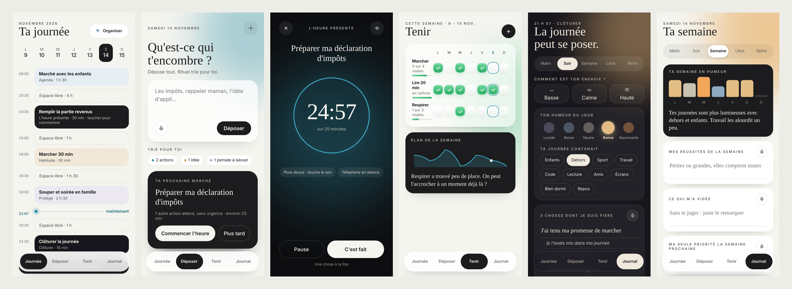

# Rituel

**Déposer ce qui encombre. Faire une chose à la fois. Tenir sans se juger. Clôturer sa journée.**

*Une application d'organisation et de journaling, calme et sans pression.*

---

## L'idée

La plupart des applis d'organisation demandent d'en faire toujours plus : des listes sans fin, des scores, des séries de jours à ne pas casser. Au bout de deux semaines, elles culpabilisent plus qu'elles n'aident.

Rituel part du principe inverse. Ce n'est pas un outil pour faire plus, c'est un espace pour **alléger la tête**, avancer sur ce qui compte, et finir la journée en paix.

L'application tient en quatre gestes.

### 1 · Déposer
Tout ce qui tourne dans la tête (tâches, idées, inquiétudes) se dépose au même endroit, à l'écrit ou **à la voix**. Rituel trie et ne renvoie **qu'une seule prochaine marche**, jamais une liste.

### 2 · Faire
L'heure présente : un écran plein, une seule intention, un minuteur et une ambiance sonore douce. Rien d'autre.

### 3 · Tenir
Les habitudes se suivent **en nombre de fois par semaine**, pas en séries de jours. On touche une case, elle devient verte. Une vague montre l'élan de la semaine, avec des mots plutôt que des pourcentages.

### 4 · Clôturer, et se relire
Le soir, un journal court : son énergie, son humeur, trois fiertés et **ce qui les a rendues possibles**, ce qu'on a appris. Le dimanche, une revue de la semaine pour choisir une seule priorité et préparer l'obstacle qui risque de l'arrêter.

---

## Le journaling, au cœur de l'appli

Rituel s'appuie sur des exercices d'écriture courts, étudiés en psychologie positive, plutôt que sur des pages blanches :

| Moment | Ce qu'on y écrit | D'où ça vient |
|---|---|---|
| **Matin** | Gratitude, ce qui rendrait la journée bonne, une intention | *The Five Minute Journal* |
| **Soir** | Trois fiertés et **grâce à quoi**, ce qui a donné de l'élan, ce qu'on a appris | *Three Good Things* (Seligman) |
| **Semaine** | Réussites, ce qui a vidé, une priorité, l'obstacle et le plan « si… alors… » | *WOOP* (Oettingen) |
| **Page libre** | Écrire sans s'arrêter pendant cinq minutes | *Morning Pages* (Cameron), en version courte |

Avec le temps, Rituel relie l'humeur et les activités de chaque jour, et montre doucement **ce qui recharge** et ce qui pèse.

Et les jours où l'énergie est basse, l'appli ressort une ancienne fierté du **bocal des fiertés**.

---

## Les principes

- **Pas de score, pas de série, pas de badge.** Le langage décrit, il ne juge jamais.
- **Pas de notification qui culpabilise.** Seule l'heure en cours peut s'afficher sur l'écran verrouillé.
- **Tout est facultatif et court.** Un champ rempli, c'est déjà bien.
- **Vos données restent sur votre téléphone.** Pas de compte, pas de publicité.
- **Un design apaisant :** papier crème, encre profonde, verre dépoli, transitions douces, et un mode nuit pour le soir.

---

## Où en est le projet

Rituel est aujourd'hui **une application Android à usage personnel**. Elle réunit et prolonge trois prototypes antérieurs, dont *Presence*. Le code source est privé.

## Collaborations

Une idée, un retour, une envie de collaboration ou d'accès anticipé ?
📩 **florence.jaymes@gmail.com** · [LinkedIn](https://www.linkedin.com/in/florence-jaymes)

---

© 2026 Florence Jaymes. Tous droits réservés. Les textes, visuels et le concept présentés ici ne peuvent être réutilisés sans autorisation écrite.
