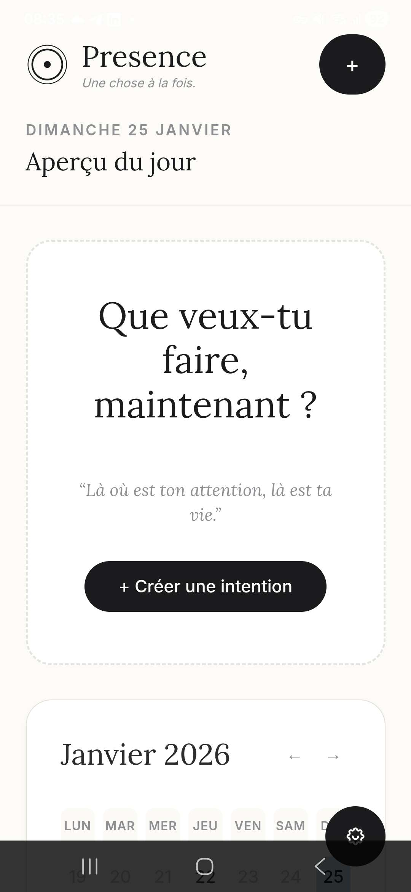
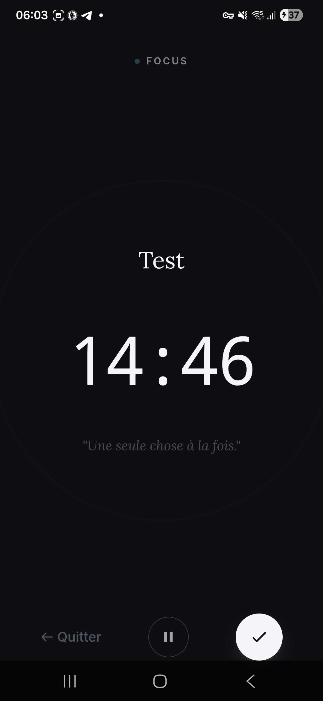
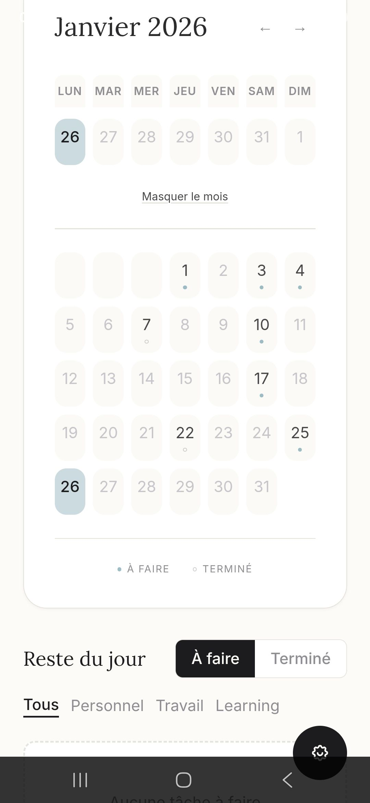

# Presence

**One thing at a time.  
Be fully present in the current hour.**

---

## What is Presence?

Presence is a mindful productivity application designed to reduce cognitive overload  
and restore focus to the present moment.

Unlike traditional productivity tools that expose endless task lists and future anxiety,  
Presence surfaces only what matters *right now*.

---

## Why this exists

Most productivity tools create mental noise:

- They display everything at once (past delays, future tasks, performance metrics)
- They encourage tracking over doing
- They optimize for quantity, not quality of attention

**Presence starts from a different premise:**

> Human attention fragments when the temporal horizon is too wide.

Instead of managing *everything*,  
Presence helps you inhabit *one hour*.

---

## Core principle: The Present Hour

Presence implements a deliberately minimal protocol:

- **One active intention** at a time  
- **Short focus sessions** (25–60 minutes)  
- **No visible performance metrics**  
- **No gamification, no streaks, no scores**

At the end of a session, you:

1. Observe what happened  
2. Without judgment  
3. Then choose (or not) the next intention  

Presence doesn't measure your life.  
It helps you **be present in an hour**.

---

## Key design decisions

Presence **deliberately refuses** to be:

- A long-term agenda  
- A project management system  
- A performance optimization tool  

It occupies a precise space:

> Conscious execution, here and now.

**Concrete implications:**

- Calm, breathing interface  
- Projects reduced to simple tags  
- Discreet, non-anxious calendar  
- Zero visible statistics  

---

## Preview

---

## Tech stack

- **React 18** + **TypeScript**
- **Zustand** (state management)
- **Vite** (build tooling)
- **Capacitor** (Android deployment)
- **Vercel** (web hosting)

---

## My role

- Product conception & UX design  
- Frontend development  
- State architecture & navigation flows  
- Deployment & project structure  

---

## Project status

- Functional MVP  
- Web version deployed  
- Android build tested on physical device  
- Used and refined in real-world conditions  

👉 **Demo:** *(coming soon)*

---

## Documentation

Extended product, UX, and architecture documentation is maintained separately in `/docs`.

This separation reflects a structured product and technical approach,  
keeping internal specifications out of the main presentation.

---

**Presence** — *Faire moins, mais le faire pleinement.*
